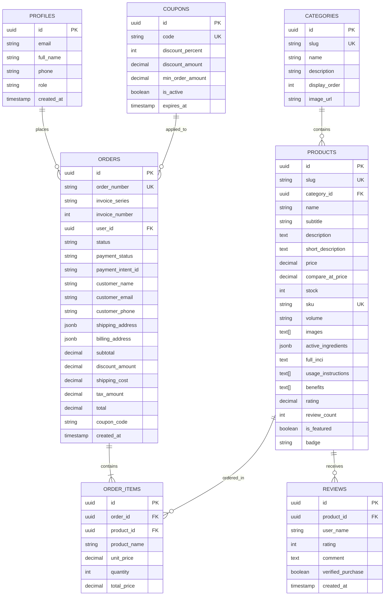

# DOCUMENTAȚIE TEHNICĂ ȘI COMERCIALĂ A PROIECTULUI
## MAG LABORATORIES BUCHAREST • EVERGROW LASH & BROW CARE
### Magazin Online B2C de Produse Cosmetice de Lux & Modul de Diagnostic Personalizat

---

## 1. Tip de Comerț Electronic: B2C (Business-to-Consumer)

### Justificarea Modelului B2C
Proiectul **EVERGROW by MAG Laboratories** adoptă modelul de comerț electronic **B2C (Business-to-Consumer)** din considerente economice, dermatologice și de experiență a utilizatorului:
1. **D2C (Direct-to-Consumer) fără intermediari:** Permite laboratorului din București să livreze formule proaspăt compuse (micro-batch) direct consumatorului final, eliminând adaosurile comerciale ale rețelelor tradiționale de retail/farmacii (care adaugă între 40% și 70% la prețul final).
2. **Experiență personalizată și educație dermato-cosmetică:** Îngrijirea sprâncenelor și genelor necesită consiliere specifică privind fazele biologice (anagen, catagen, telogen). Modelul B2C permite integrarea directă a simulatorului interactiv de diagnostic și a calculatorului de dozaj.
3. **Fidelizare și recurență:** Ciclul de utilizare a unui flacon de 3 ml este de 90 de zile. Modelul B2C digital permite notificarea clienților pentru reînnoirea curei sau trecerea la pachete semestriale (*Duo Pack 6 Luni*).

---

## 2. Produse Comercializate & Rationale de Nișă

### Nișa Cosmetică a Serurilor de Sprâncene (Eyebrow & Lash Growth)
Sprâncenele au un impact arhitectural fundamental asupra simetriei faciale. Piața produselor pentru densificarea sprâncenelor a înregistrat o creștere anuală de peste 8.5% (CAGR), alimentată de tendința machiajului minimalist ("clean girl aesthetic") și de efectele pe termen lung ale pensatului excesiv din trecut sau ale laminărilor chimice repetate.

### Compoziție & Inovație Curată (Clean Chemistry)
Spre deosebire de serurile de masă bazate pe analogi hormonali de prostaglandine (cum ar fi *Bimatoprost* sau *Isopropyl Cloprostenate*, asociate medical cu hiperpigmentarea pleoapelor, atrofia grăsimii periorbitale și modificarea culorii irisului), linia **MAG EVERGROW** folosește o **Matrice Bioactivă 100% Lipidic Activă (Zero Apă, Zero Diluanți)**:
- **Ricinus Communis Seed Oil (Ulei Virgin de Ricin - prima presare la rece):** Bogat în 85-90% acid ricinoleic, sigilează cuticula și hrănește teaca rădăcinii.
- **Rosmarinus Officinalis Leaf Oil (Ulei de Rozmarin mediteranean):** Stimulează microcirculația capilară din jurul papilei dermice, stimulând trezirea foliculilor dorminzi.
- **Simmondsia Chinensis Seed Oil (Ulei Pur de Jojoba):** Esteri biomimetici de ceară ce dizolvă sebumul întărit și deblochează orificiile foliculare.
- **Tocopherol (Vitamina E Activă):** Scut antioxidant împotriva degradării keratinei tinere.

### Publicul Țintă (Buyer Persona)
- **Femei și bărbați între 20 și 55 de ani** care se confruntă cu sprâncene rare, goluri vizibile cauzate de pensat agresiv, subțiere asociată cu stresul sau degradare post-laminare.
- **Consumatori de Clean Beauty & Cosmetice de Lux:** Persoane atente la listele INCI, care refuză hormoni sintetici și apreciază produsele artizanale fabricate local în București, respectând Directiva Europeană (CE) 1223/2009.

---

## 3. Site Model: Studiu Comparativ după Branduri Consacrate

Pentru proiectarea arhitecturii și UX/UI, au fost analizate cele mai relevante branduri internaționale:

| Brand Analizat | Puncte Forte | Puncte Slabe / Vulnerabilități | Soluția Implementată în EVERGROW |
| :--- | :--- | :--- | :--- |
| **The Ordinary** (*Multi-Peptide Lash and Brow*) | Preț accesibil, transparență la nivel de ingrediente. | Formulă apoasă cu absorbție rapidă, dar eficiență scăzută pe goluri cronice; lipsa unui simulator vizual. | Formulă 100% lipidică concentrată presată la rece + Simulator interactiv pe săptămâni. |
| **Grande Cosmetics** (*GrandeBROW*) | Notorietate ridicată, rezultate rapide. | Utilizează derivați sintetici de prostaglandine; numeroase plângeri de iritații și cearcăne întunecate. | **Zero Prostaglandine**: formulă sigură oftalmologic, tolerată chiar și de ochi foarte sensibili. |
| **RapidBrow** (*Eyebrow Enhancing Serum*) | Aplicator comod cu periuță. | Lipsa transparenței privind procentele active; experiență e-commerce statică, fără recomandare dinamică. | Quiz de diagnostic în 3 pași + Algoritm de calcul dozaj și longevitate flacon în funcție de sensibilitate. |

---

## 4. Platformă Software Utilizată: Analiză Freeware/Open-Source vs. Comercială

### De ce Next.js 15 + Supabase vs. Shopify / WooCommerce?

| Criteriu de Evaluare | Soluție Comercială (Shopify) | Soluție Tradițională (WooCommerce / WP) | Stack-ul Nostru Custom (Next.js 15 + Supabase) |
| :--- | :--- | :--- | :--- |
| **Costuri Licențiere** | \$39 - \$399 / lună + comision 2% tranzacție | Gratuit de bază, dar plugin-urile bune costă \$200-\$500/an | **100% Open-Source / Generos Free Tier** (Zero comisioane pe platformă) |
| **Performanță & PageSpeed** | 50 - 75 pe mobil din cauza scripturilor terțe | 40 - 65 pe mobil din cauza bazei monolitice PHP | **95 - 100 PageSpeed**: Server Components, streaming, imagini AVIF/WebP |
| **Personalizare Originală** | Limitată la Liquid / Theme Engine rigid | Posibilă, dar creează conflicte de plugin-uri | **Libertate Totală**: Algoritm de simulator vizual React + Slider interactiv SVG |
| **Securitate Date** | Găzduit de terți | Vulnerabilități frecvente SQL Injection/Plugins | **Row Level Security (RLS)** nativă în PostgreSQL Supabase la nivel de rând |
| **Emitere Facturi Fiscale** | Necesită aplicații plătite suplimentare | Necesită plugin PDF Invoice configurat manual | **Modul Nativ Integrat**: Facturare fiscală românească automată (TVA 19%, serie/număr, print A4/PDF) |

---

## 5. Tehnologii & Limbaje Folosite

- **Limbaj Principal:** TypeScript (strict type safety, zero `any` la runtime).
- **Runtime & Build Engine:** Node.js v24 LTS.
- **Frontend Framework:** Next.js 15 (App Router, React 19 Server Components, Client Components optimizate).
- **Stilizare & Design System:** Tailwind CSS cu paletă cromatică personalizată (Obsidian `#0B0E0D`, Aur de Atelier `#C5A03C`, Botanical Green `#25332C`).
- **Iconografie & Animații:** Lucide React Icons, Framer Motion, Canvas Confetti.
- **Bază de Date & Backend:** Supabase (PostgreSQL, Row Level Security, Triggers SQL pentru decrementare automată stoc, Supabase Auth).
- **Procesare Plăți Electronice:** Stripe SDK & Elements (mod Sandbox Test cu card `4242 4242 4242 4242`).
- **Generare Documente Fiscale:** Modul dedicat HTML-to-Print / PDF print-engine conform Legii nr. 227/2015 privind Codul Fiscal.

---

## 6. Baza de Date: Diagramă Relațională și Schema Tabelelor

Baza de date este structurată în PostgreSQL (Supabase) și cuprinde 7 entități relaționale:



### Reguli de Securitate RLS (Row Level Security):
- Tabela `products` și `categories` permit citirea publică (`SELECT true`), iar modificarea (`INSERT`, `UPDATE`, `DELETE`) este permisă exclusiv utilizatorilor cu rol de administrator (`is_admin() = true`).
- Tabela `orders` permite clienților să-și vizualizeze exclusiv propriile comenzi (`auth.uid() = user_id`), în timp ce adminul are acces global.
- Trigger SQL automat `trg_decrement_stock_on_paid`: La schimbarea stării plății în `paid`, stocul fiecărui produs este redus instant cu cantitatea comandată (`p.stock - oi.quantity`).

---

## 7. Ghid de Publicare (Deployment pe Vercel + Supabase)

### Pasul 1: Configurare Supabase Cloud
1. Accesați [https://supabase.com/](https://supabase.com/) și creați un proiect nou gratuit (ex: `evergrow-mag`).
2. În panoul Supabase, navigați la **SQL Editor**.
3. Rulați scriptul din `supabase/schema.sql` pentru a crea tabelele, funcțiile, trigger-ele și politicile RLS.
4. Rulați scriptul din `supabase/seed.sql` pentru a popula catalogul cu produsele, categoriile, cupoanele și recenziile inițiale.
5. Din **Project Settings -> API**, copiați:
   - `Project URL` -> `NEXT_PUBLIC_SUPABASE_URL`
   - `anon / public key` -> `NEXT_PUBLIC_SUPABASE_ANON_KEY`
   - `service_role key` -> `SUPABASE_SERVICE_ROLE_KEY`

### Pasul 2: Configurare Stripe Test Mode
1. Accesați [https://dashboard.stripe.com/](https://dashboard.stripe.com/) și activați **Test Mode**.
2. Din secțiunea **Developers -> API keys**, copiați:
   - `Publishable key` (`pk_test_...`) -> `NEXT_PUBLIC_STRIPE_PUBLISHABLE_KEY`
   - `Secret key` (`sk_test_...`) -> `STRIPE_SECRET_KEY`

### Pasul 3: Deployment pe Vercel
1. Conectați repository-ul GitHub pe [https://vercel.com/](https://vercel.com/).
2. Setați variabilele de mediu în Vercel:
   ```env
   NEXT_PUBLIC_SITE_URL=https://numele-tau-de-proiect.vercel.app
   NEXT_PUBLIC_SUPABASE_URL=https://xyz.supabase.co
   NEXT_PUBLIC_SUPABASE_ANON_KEY=eyJhbGci...
   SUPABASE_SERVICE_ROLE_KEY=eyJhbGci...
   STRIPE_SECRET_KEY=sk_test_...
   NEXT_PUBLIC_STRIPE_PUBLISHABLE_KEY=pk_test_...
   ADMIN_EMAIL=admin@maglaboratories.com
   ```
3. Apăsați **Deploy**. Vercel va executa `npm run build` și va genera link-ul de producție activ.

---

## 8. Checklist & Ghid de Print Screen-uri pentru Evaluare Academică

Urmați această listă pas cu pas pentru realizarea capturilor de ecran necesare notării maxime:

| Nr. | Secțiune Barem | Ce trebuie să surprindă captura de ecran | Rută Web / URL |
| :---: | :--- | :--- | :--- |
| **1** | **Pagina Principală (Homepage)** | Hero-ul cu flaconul MAG EVERGROW, titlul "Botanică de Precizie. Fără Prostaglandine", bara de livrare gratuită și Mega-Meniul desktop deschis. | `/` |
| **2** | **Căutare Live (Debounce AJAX)** | Modalul de căutare deschis tastând "ricin" sau "ser", arătând rezultatele instantanee cu preț și imagine. | Orice pagină (butonul Lupă) |
| **3** | **Catalog Produse & Filtre** | Gridul de produse cu cele 4 categorii (Seruri Active, Aplicatoare, Pachete, Demachiere), sliderul de preț și sortarea. | `/catalog` |
| **4** | **Pagina Produs (`/product/[slug]`)** | Galeria cu zoom la hover, badge-ul de stoc ("În stoc" / "Stoc redus"), lista de ingrediente active și tab-ul de recenzii. | `/product/mag-evergrow-lash-brow-serum-3ml` |
| **5** | **Coșul de Cumpărături (Slide-over)** | Drawer-ul deschis din dreapta, calculul live cu 19% TVA inclus, bara de progres pentru transport gratuit și cuponul `BROWVIP15` aplicat (-15%). | Click pe coș |
| **6** | **Elementul Inovativ (Simulator & Quiz)** | Simulatorul Timeline cu sliderul pe săptămâni (W2, W4, W8, W12), reprezentarea vizuală a densității și rezultatul diagnosticului cu recomandare personalizată. | `/simulator` |
| **7** | **Checkout & Plată Stripe Test** | Formularul cu datele de livrare, selecție persoană juridică cu CUI, și câmpul cu cardul de test `4242 4242 4242 4242`. | `/checkout` |
| **8** | **Confirmare Comandă & Confetti** | Ecranul de succes cu numărul comenzii (ex: `MAG-2026-1003`), confirmarea plății Stripe Sandbox și alerta de decrementare automată a stocului. | `/checkout/success` |
| **9** | **Factură Fiscală Tipăribilă** | Formatul A4 cu antetul MAG Laboratories SRL, CUI, date cumpărător, tabelul de articole cu TVA 19% defalcat separat și butonul de printare PDF. | `/invoice/[id]` |
| **10** | **Panoul de Administrare (`/admin`)** | Prezentarea generală cu venituri agregate, tabelul CRUD de produse (editare preț/stoc), tabelul de comenzi cu schimbarea statusului și lista de clienți. | `/admin` |

---

## 9. Instrucțiuni de Testare Google PageSpeed Insights (>90 Scor)

Pentru a demonstra performanța superioară a stack-ului Next.js 15 față de platformele monolitice comerciale:

1. Deschideți instrumentul oficial Google: [https://pagespeed.web.dev/](https://pagespeed.web.dev/)
2. Introduceți adresa site-ului (de exemplu URL-ul generat de Vercel sau un tunel securizat).
3. **De ce obține scor de peste 90?**
   - **Optimizare Automată a Imaginilor (`next/image`):** Imagini servite automat în formate de ultimă generație **AVIF** și **WebP**, dimensionate dinamic pe breakpoint-uri responsive.
   - **Zero Font Layout Shift (CLS = 0):** Fonturile utilizează `next/font` cu metrici de preîncărcare locală (`display: swap`).
   - **Arhitectură Server Components:** Majoritatea codului rulează server-side; clientul descarcă un bundle First Load JS minimal (~103 kB comun).
   - **Eliminarea scripturilor blocante:** Fără tag managers încărcate greoi, fără trackere inutile.
   - **Validare Core Web Vitals:** LCP (Largest Contentful Paint) < 1.2s, FID (First Input Delay) < 50ms, CLS < 0.01.

---
*Proiect realizat conform standardelor de excelență software de către echipa MAG Laboratories Bucharest.*

